<p align="center">
  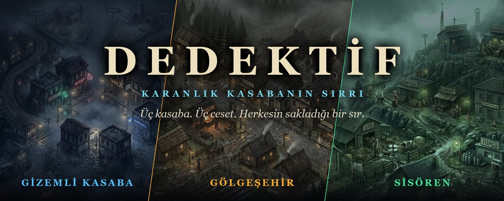
</p>

<p align="center">
  <b>Telgraf gece yarısı geldi. Bir ceset, korkmuş bir kasaba ve konuşmak istemeyen insanlar.</b><br>
  Türkçe noir dedektiflik oyunu. Aynı cinayetleri ister tarayıcıda tıklayarak, ister 3D sokaklarda yürüyerek çöz.
</p>

<p align="center">
  
  
  
  
</p>

<p align="center">
  <a href="#kurulum"><b>▶ Hemen Kur ve Oyna</b></a> ·
  <a href="#sürümler">Sürümler</a> ·
  <a href="#kasabalar">Kasabalar</a> ·
  <a href="#nasıl-oynanır">Nasıl Oynanır</a> ·
  <a href="#kontroller">Kontroller</a> ·
  <a href="#geliştirme-durumu">Geliştirme Durumu</a>
</p>

---

> *Yağmur üç gündür dinmedi. Telgraf gece yarısı geldi: bir ceset, korkmuş bir kasaba ve herkesin sakladığı bir sır. Otuz beş yaşında, yorgun ama keskin gözlü bir dedektifsiniz — ve bu gece yine yola çıkıyorsunuz.*
>
> — Oyunun açılış ekranından

Dükkânlara girer, çekmeceleri karıştırır, delilleri laboratuvarda tarar, şüphelileri sorguya çekersin. Sonunda tek bir kişiyi işaret etmen gerekir. **Yanılırsan masum biri hapse girer, gerçek katil de elinden kaçar.**

**Çözümü ezberleyemezsin.** Katil her yeni davada yeniden seçilir. Aynı kasabayı ikinci kez açtığında eski cevabın işe yaramaz.

<table>
  <tr>
    <td align="center"><h3>3</h3>açık kasaba</td>
    <td align="center"><h3>26</h3>şüpheli</td>
    <td align="center"><h3>112</h3>delil</td>
    <td align="center"><h3>35</h3>okunabilir belge</td>
    <td align="center"><h3>5</h3>şüpheli başına soru hakkı</td>
  </tr>
</table>

## Sürümler

Oyun tarayıcıda başladı, sonra Unity ile 3D'ye taşındı. İki sürüm aynı üç cinayeti ve aynı ana kuralları paylaşır, ama oynanış hissi ve bazı özellikler farklıdır. Bu sayfada 🎮 **3D**, 🌐 **Web** anlamına gelir.

<table>
  <tr>
    <th width="50%">🎮 3D — Sokaklarda yürü</th>
    <th width="50%">🌐 Web — Tıkla ve bul</th>
  </tr>
  <tr>
    <td>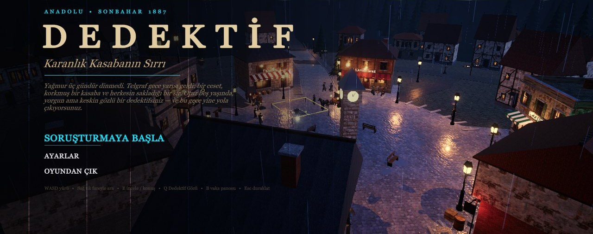</td>
    <td>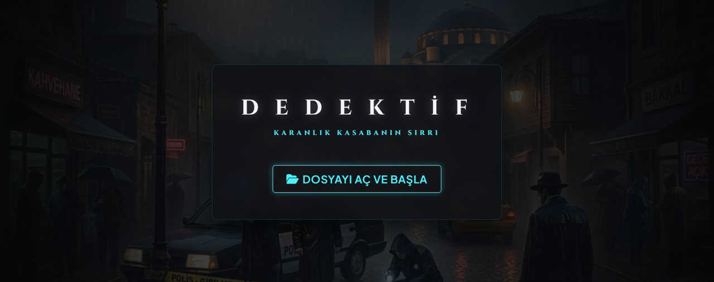</td>
  </tr>
  <tr>
    <td>Yürünebilir kasabalar ve odalar, üçüncü şahıs kamera, 1887 Anadolu'su. Gün döngüsü ve Dedektif Gözü bu sürümde.</td>
    <td>Çizim haritalar, gerçekçi iç mekânlar ve portreler. Sokaktaki insanlarla konuşmak, kendi şüpheli panonu kurmak bu sürümde.</td>
  </tr>
</table>

| | 🎮 3D (Unity) | 🌐 Web |
|---|---|---|
| **Kurulum** | Unity ile derlenir, sonra tek `.exe` | [.NET 10](#web-sürümünü-kur) ve tarayıcı, en hızlı yol |
| **İlerleme** | Kasabalar sırayla açılır: doğru suçlama bir sonrakinin kilidini açar | Üç kasaba da baştan açık, istediğinden başla |
| **Dönem** | 1887'ye uyarlandı: hayal feneri, gazyağcı, zaptiye | Noir ama daha modern: sinema, tüpçü, neon tabelalar |
| **Sokakta ve mekânlarda yan karakterlerle konuşma** | Yok, şüpheliler ve rehberlerle konuşulur | Sisören'de 16 yan karakter |
| **Şüpheli panosu** | Şüpheliyi masum ilan ederek daraltırsın | Aynısı, Sisören'de konuştuğun kasabalılar da eklenir |
| **Delil incelemesi** | Odadaki 3D nesneler, saklama yerleri | Dört açıdan döndürülen delil görselleri |
| **Yalnızca bu sürümde** | Dedektif Gözü, gün döngüsü, 3D vaka haritası, otomatik kayıt | Fehmi Bey'in kapı sahnesi, mühürlü görev zarfı |
| **Serbest soru** | Yerel eşleştirme, [sunucu bağlıysa](#3d-oyunu-yapay-zekâ-sunucusuna-bağla) yapay zekâ motoru | Yerel Türkçe motor, isteğe bağlı Gemini |

## Kasabalar

<table>
  <tr>
    <td width="50%">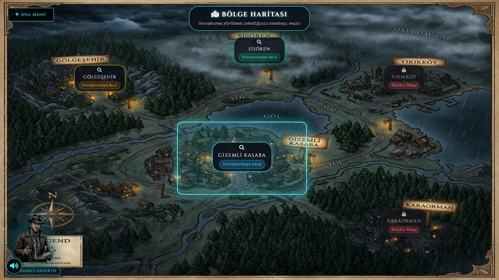<br><sub>🌐 <b>Bölge haritası:</b> yollar, göl ve sisli dağlar.</sub></td>
    <td width="50%">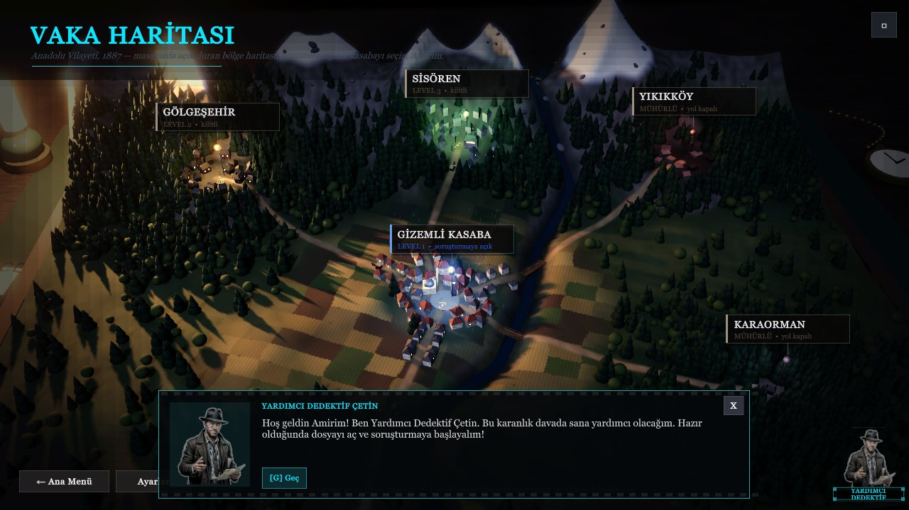<br><sub>🎮 <b>Vaka haritası:</b> dedektifin masasındaki 3D maket.</sub></td>
  </tr>
</table>

| | Gizemli Kasaba | Gölgeşehir | Sisören |
|---|---|---|---|
| **Maktul** | Tüccar Osman Bey | Tüccar Ekrem Bey | Tefeci Vahap Efendi |
| **Tema** | 🔵 Mavi, hafif yağmur | 🟡 Sarı, fırtına | 🟢 Yeşil, yoğun sis |
| **Şüpheli ve bina** | 5 | 8 | 13 |
| **Delil** | 15 | 32 | 65 |
| **Otopsi şartı** | 3 bina + 3 bulgu | 4 bina + 4 bulgu | 5 bina + 5 bulgu |
| **Çanta** | 5 delil | 5 delil | 8 delil |
| **Rehber** | Çetin | Çetin ve Bekçi Rıfat | Çetin ve Tüccar İlyas |

### Gizemli Kasaba

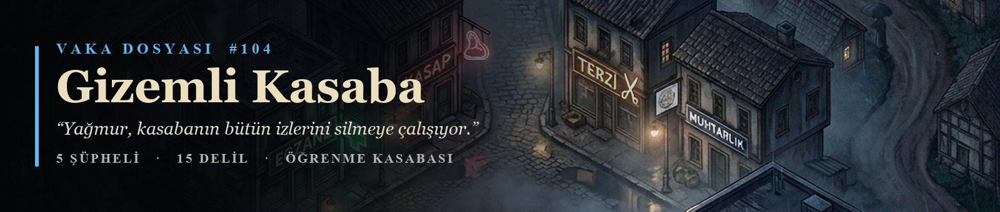

Yağmurlu bir sonbahar gecesi, tüccar Osman Bey'in cesedi meydanın parke taşlarında bulunuyor. Kordonun arkasındaki kalabalık birbirine şüpheyle bakıyor. Mesleğini burada öğrenirsin: az şüpheli, hafif hava ve sistemleri tanımaya yetecek zaman.

<table>
  <tr>
    <td width="50%">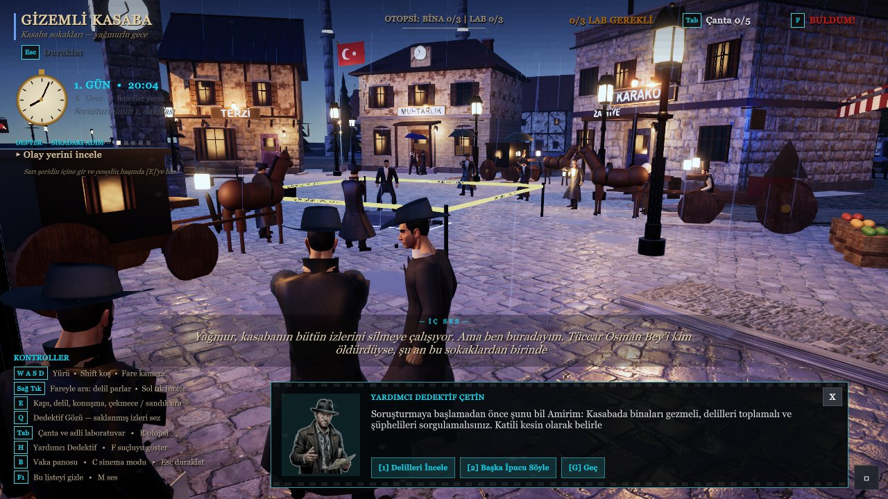<br><sub>🎮 Meydan: şeritli olay yeri, atlı arabalar ve kalabalık.</sub></td>
    <td width="50%">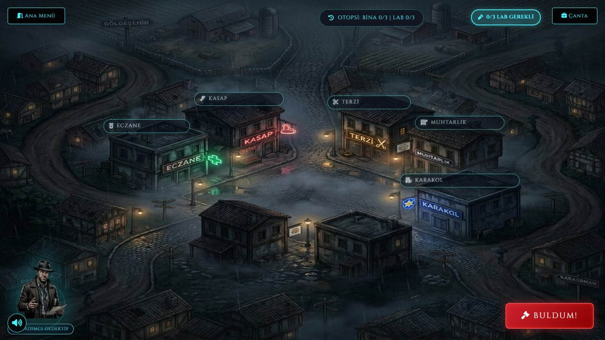<br><sub>🌐 Sisli harita: her tabelanın arkasında bir şüpheli.</sub></td>
  </tr>
</table>

**Bu kasabaya özel**

- **Oyunun öğrenme kasabası.** Yardımcı Dedektif Çetin sistemleri adım adım anlatır. Otopsi raporu için üç bina ve üç adli bulgu yeterlidir.
- **Beş kişilik, sıkı bir çember.** Kasap, eczacı, muhtar, komiser ve terzi. Delilleri saklamakla suçlanan komiser de listede, yani kanuna da güvenemezsin.
- 🎮 **Sakin ama ıslak sokaklar.** Hafif yağmur, gök gürültüsü yok. Sarı şerit kasabalıları durdurur, seni değil: içeri girip cesedi kendin incelersin.
- 🌐 **Gözden kaçan deliller.** Bazı deliller ilk bakışta görünmez, odayı dikkatle taraman gerekir.

<details>
<summary><b>Şüpheliler (5)</b></summary>

| İsim | Mekân | Bilinen |
|---|---|---|
| **Kasap Hasan** | Kasap | Satırıyla ve sert mizacıyla tanınan eski kasap. |
| **Eczacı Selma** | Eczane | İlaçlar ve zehirli bitkiler konusunda uzman. |
| **Muhtar Kemal** | Muhtarlık | Kurbanla arazi anlaşmazlığı olan kasaba muhtarı. |
| **Komiser Güneş** | Karakol | Olay yerini ilk inceleyen, delilleri saklamakla itham edilen komiser. |
| **Terzi Yahya** | Terzi | Kurbanın ceketine gizli cep diken ve onu son gören kişi. |

</details>

### Gölgeşehir

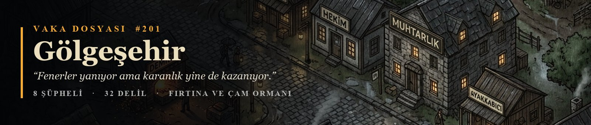

Fırtınalı bir gece, çam ormanının kıyısında kasabanın en zengin ve en tekinsiz tüccarı Ekrem Bey ölü bulunuyor. Gaz lambalarının sarısı karanlığa zor direniyor. Kırk yıldır bu taşlarda nöbet tutan bekçi fenerini sana ödünç veriyor, ama Çetin'in kitaplarına pek güvenmiyor:

> *"Bana bak mektepli dedektif, senin o laboratuvar kitapların bu sisli sokakları kurtarmaz! […] Kimin kimle hesabı olduğunu sadece benim fenerim aydınlatır!"*
>
> — Bekçi Rıfat

<table>
  <tr>
    <td width="50%">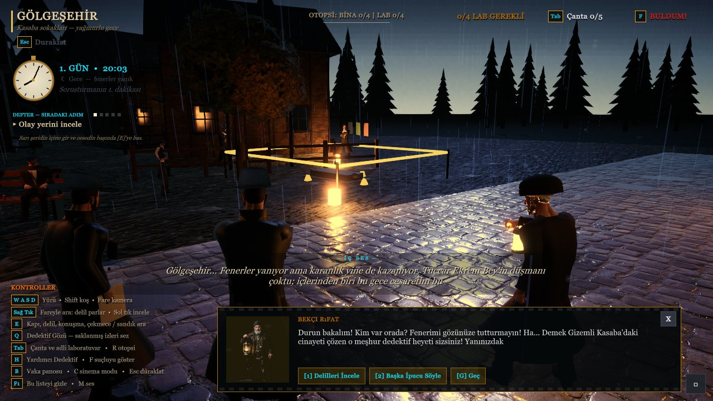<br><sub>🎮 Islak taşlar, çam siluetleri ve fenerli Bekçi Rıfat.</sub></td>
    <td width="50%">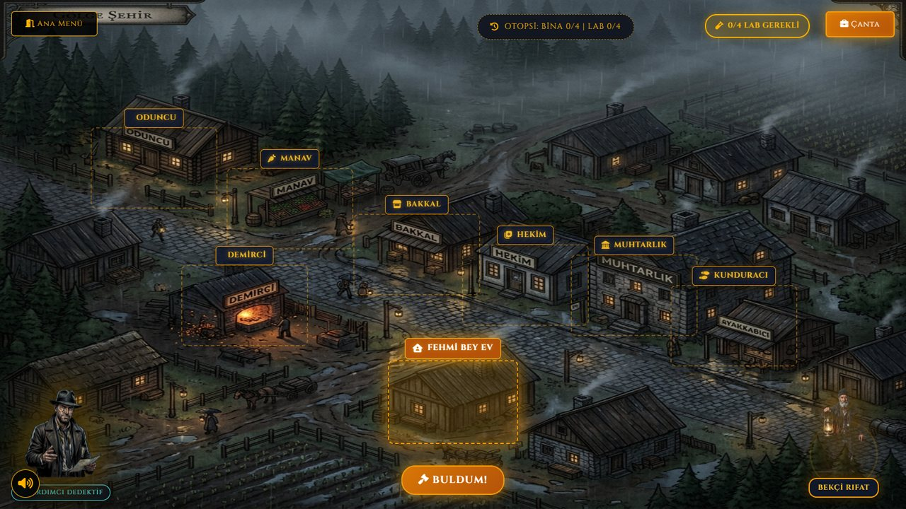<br><sub>🌐 Sekiz mekân, sekiz şüpheli ve yağmurda bir kasaba.</sub></td>
  </tr>
  <tr>
    <td>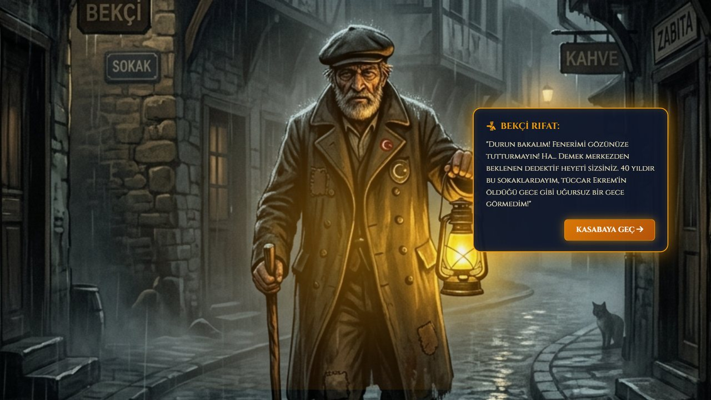<br><sub>🌐 Bekçi Rıfat seni fenerle karşılar.</sub></td>
    <td>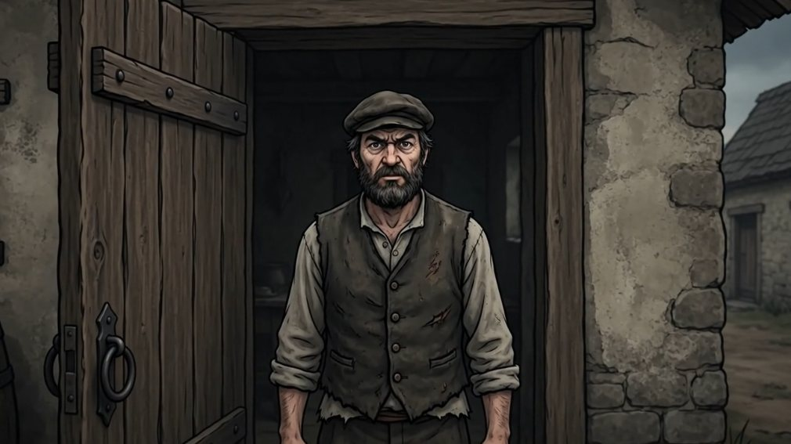<br><sub>🌐 Fehmi Bey'in kapısı: çalarsın, ama açılması iyi haber değil.</sub></td>
  </tr>
</table>

**Bu kasabaya özel**

- **Yanında yerel bir rehber var.** Bekçi Rıfat kasabayı ve insanlarını anlatır. 🎮 Sokaklarda seninle yürür, konuşmak için yanına gidersin. 🌐 Ekrandaki düğmeyle ona danışırsın.
- 🌐 **Fehmi Bey kapıyı yüzüne çarpar.** Emekli muallim yabancılardan hoşlanmaz. Kapıyı çalarsın, kapı suratına kapanır ve karar senindir: **zorla mı gireceksin, haritada mı kalacaksın?**
- 🌐 **Mühürlü görev zarfı.** Dava, balmumu mührünü kırdığın bir emniyet zarfıyla başlar.
- 🎮 **Gerçek bir fırtına.** Sağanak, gök gürültüsü ve daha karanlık bir kasaba. Gizemli Kasaba'nın rahatlığı burada biter.
- **Çıta yükselir.** Otopsi için dört bina ve dört bulgu gerekir, bina başına düşen delil de artar.

<details>
<summary><b>Şüpheliler (8)</b></summary>

| İsim | Mekân | Bilinen |
|---|---|---|
| **Oduncu Tahsin** | Oduncu | Çam ormanında çalışan, Ekrem Bey'le arasında husumet olan oduncu. |
| **Manav Ayşe** | Manav | Dükkânı borç yüzünden haciz tehdidi altında. |
| **Demirci Kazım** | Demirci | Kurbanın çelik kasasını kendi elleriyle yapan suskun usta. |
| **Bakkal Naciye** | Bakkal | Kasabanın bütün havadisi onun tezgâhından geçer. |
| **Hekim Sevgi** | Hekim | Kasabanın şifa kaynağı, rafındaki otların bir kısmı zehirli. |
| **Muhtar Cevdet** | Muhtarlık | Adı çam ormanı arazisinin tapusuyla birlikte anılıyor. |
| **Fehmi Bey** | Fehmi Bey'in evi | Gece 02.14'te sesler duyduğunu söyleyen emekli öğretmen. |
| **Kunduracı Rasim** | Kunduracı | Çizmedeki çamurdan insanın nereden geldiğini anladığını söylüyor. |

</details>

### Sisören

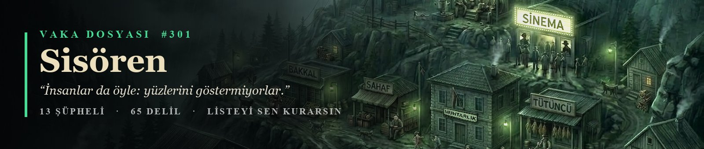

Dağların tepesinde, dış dünyadan kopuk bir kasaba. Sis gündüz de kalkmaz, telgraf telleri rüzgârda vızıldar. Tefeci Vahap Efendi sisli bir gece yarısı öldürülmüş. Herkesin borcunu bilen Tüccar İlyas sana rehberlik etmek istiyor. Çetin ise ona güvenip güvenemeyeceğinden emin değil.

> *"13 farklı mekân, 13 farklı şüpheli. Kimin dost, kimin düşman olduğu belirsiz. […] **Şüpheliler listesini bu sefer sen oluşturuyorsun...**"*
>
> — Sisören vaka dosyası

<table>
  <tr>
    <td width="50%">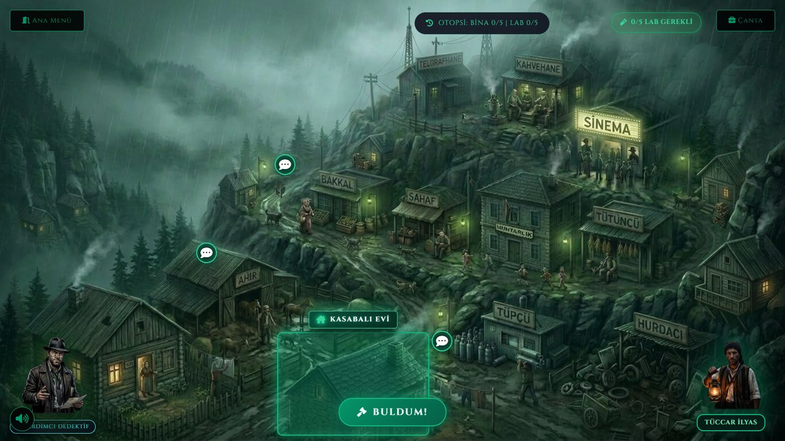<br><sub>🌐 Yamaçtaki kasaba. Konuşma balonları sokakta durdurabileceğin insanları gösterir.</sub></td>
    <td width="50%">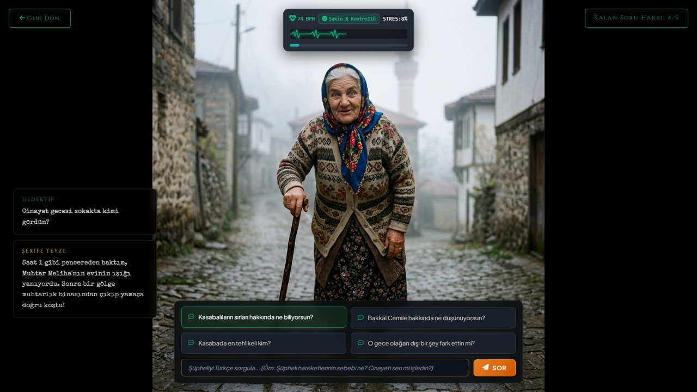<br><sub>🌐 Sokakta Şerife Teyze: pencereden gördüklerini anlatıyor.</sub></td>
  </tr>
  <tr>
    <td>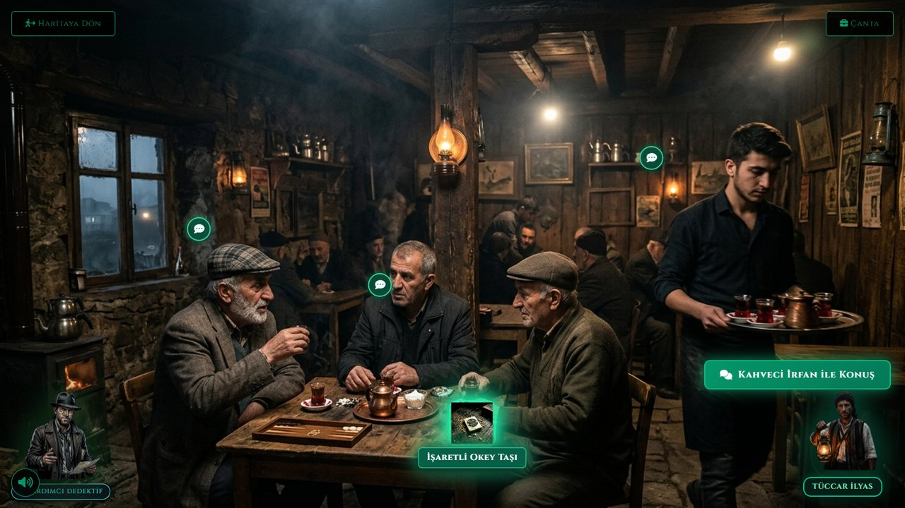<br><sub>🌐 Kahvehanede masadakilerle de konuşabilirsin. Masanın üstünde bir delil duruyor.</sub></td>
    <td>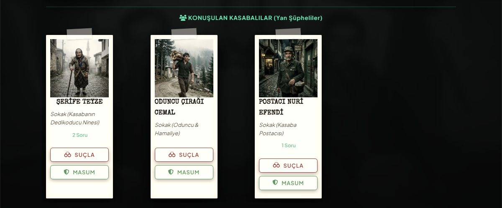<br><sub>🌐 Konuştuğun herkes panoya <i>Yan Şüpheli</i> olarak düşer.</sub></td>
  </tr>
  <tr>
    <td colspan="2">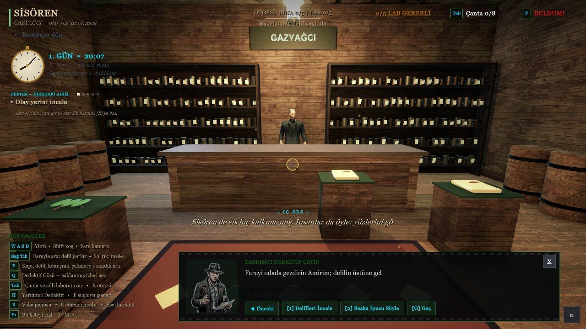<br><sub>🎮 3D Sisören'de Gazyağcı Şevket'in dükkânı. Sinema burada hayal fenerine, tüpçü de gazyağcıya dönüşür.</sub></td>
  </tr>
</table>

**Bu kasabaya özel**

- 🌐 **Şüpheli listesini sen kurarsın.** 13 ana şüpheli panoda seni bekler, ama panonun son hâlini sen belirlersin. Konuştuğun her kasabalı *Konuşulan Kasabalılar* bölümüne eklenir, ikna olduklarını masum ilan edip listeden düşersin.
- 🌐 **Sokaktaki insanlarla konuşabilirsin.** Şerife Teyze, Oduncu Çırağı Cemal ve Postacı Nuri Efendi haritada seni bekler. Binaya girmen gerekmez, üstlerine tıklaman yeterli.
- 🌐 **Her mekânda başka gözler.** Dokuz yan karakter ve dört çocuk dükkânlarda ve kahvehanede durur. Çocuklar da konuşur, gördüklerini de anlatır. Sahafta resim çizen Selin'e çizdiği siyah paltolu adamı sor.
- **Güvenilmez bir rehber.** Tüccar İlyas dağları avucunun içi gibi bilir. Söylediklerine inanıp inanmamak sana kalmış.
- **En büyük soruşturma.** 13 bina, 65 delil, otopsi için beş bina ve beş bulgu. Bu yüzden çantan da daha büyük: 8 delil.
- 🎮 **Yağmursuz korku.** Sisören'de yağmur yağmaz: yoğun sis, rüzgâr ve uzaktan gelen ulumalar vardır.

> [!NOTE]
> Yan karakterler şimdilik yalnızca web sürümünde. 3D Sisören'de sokaklarda kasabalılar dolaşır ama konuşmazlar. Orada 13 şüpheli ve rehberlerle konuşur, listeyi masum ilan ederek daraltırsın.

<details>
<summary><b>Spoiler: yan şüpheliler nasıl işler?</b></summary>

Katil her zaman 13 ana şüpheliden biridir. Bir yan karakteri suçlarsan *"BU KİŞİ MASUMDUR!"* kartı çıkar, dava kapanmaz ve panoya dönersin. Yani onlarla konuşmanın bedeli yoktur, ama söyledikleri seni asıl şüphelilere götürebilir.

</details>

<details>
<summary><b>Şüpheliler (13)</b></summary>

| İsim | Mekân | Bilinen |
|---|---|---|
| **Telgrafçı Rüstem** | Telgrafhane | Kasabanın sırlarını tellerden dinleyen adam. |
| **Kahveci İrfan** | Kahvehane | Borç listeleri ve işaretli taşlarla dolu bir kahvehane işletiyor. |
| **Hayalî Nejat** *(web: Sinemacı)* | Hayal Feneri *(web: Sinema)* | Perde arkasında başka işler çeviren gösterici. |
| **Bakkal Cemile** | Bakkal | Veresiye defteri kabarık, tezgâhının altında kaçak tütün var. |
| **Sahaf Hikmet** | Sahaf | İçi oyulmuş kitaplarda sır saklayan ihtiyar. |
| **Muhtar Meliha Hanım** | Muhtarlık | Silinmiş kütükler ve kırık bir mühürle anılan güçlü muhtar. |
| **Tütüncü Nermin Hanım** | Tütüncü | İthal tütünün arkasında zarif ama sert biri. |
| **Çoban Durmuş** | Ahır | Sürüsünü her şeyden üstün tutan çoban. |
| **Gazyağcı Şevket** *(web: Tüpçü)* | Gazyağcı *(web: Tüpçü)* | Kurbanın evine son teslimatı yapan satıcı. |
| **Hurdacı Zehra** | Hurdacı | Dükkânına gelen her hurdanın izini bilir. |
| **Zeynep Teyze** | Kasabalı evi | Penceresinden gördüklerini anlatmaya hazır. |
| **Hatice Nine** | Kasabalı evi | Kasabanın yaşayan hafızası. |
| **Emine Hanım** | Yamaç evi | Yamacın tepesinde tek başına dokuma yapan sessiz kadın. |

</details>

## Nasıl Oynanır

1. **Dosyayı aç.** Haritadan bir kasaba seç. 3D'de Gizemli Kasaba'dan başlarsın, web'de üçü de açıktır.
2. **Olay yerini incele.** Çetin yanındadır, takılırsan ondan ipucu alırsın.
3. **Binaları gez.** Odayı ara, delilleri çantaya al, şüpheliyi sorgula. İnceleme bitince o binaya geri dönemezsin, oyun çıkmadan önce uyarır.
4. **Laboratuvara gönder.** Binadan çıkınca çantayı aç, delilleri UV ve tozla tara, bulguları Adli Tıp'a yolla. Laboratuvar bina içinde çalışmaz.
5. **Otopsi raporunu al.** Yeterli bina ve bulguya ulaşınca sayaç başlar, ardından rapor açılır.
6. **"BULDUM!" de.** Masum olduğuna inandıklarını listeden düş, kalanlardan birini suçla.

Karar sonrasında gerçek katil ve cinayetin hikâyesi açıklanır.

<table>
  <tr>
    <td width="50%">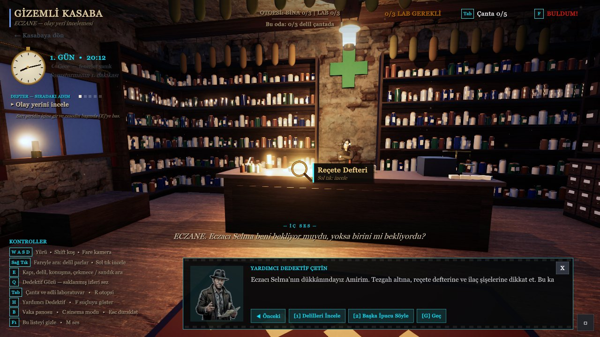<br><sub>🎮 <b>Fareyle arama:</b> imleci odada gezdir, delil üstüne gelince parlar. Çekmece, sandık ve gevşek tahtaları da aç.</sub></td>
    <td width="50%">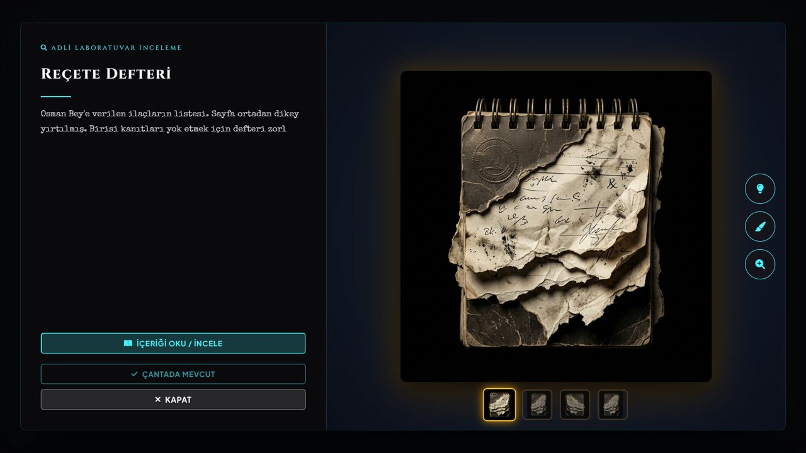<br><sub>🌐 <b>Adli laboratuvar:</b> delili dört açıdan incele, UV ve toz uygula, büyüteçle yaklaş.</sub></td>
  </tr>
  <tr>
    <td>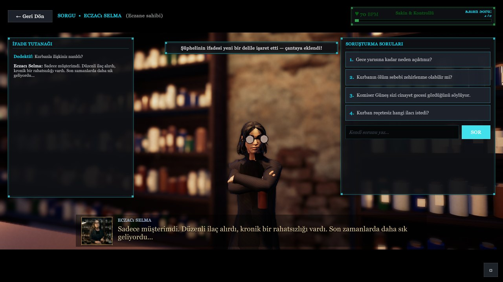<br><sub>🎮 <b>Sorgu:</b> ifade tutanağı, nabız ve serbest soru kutusu. Bazı cevaplar yeni bir delile işaret eder.</sub></td>
    <td>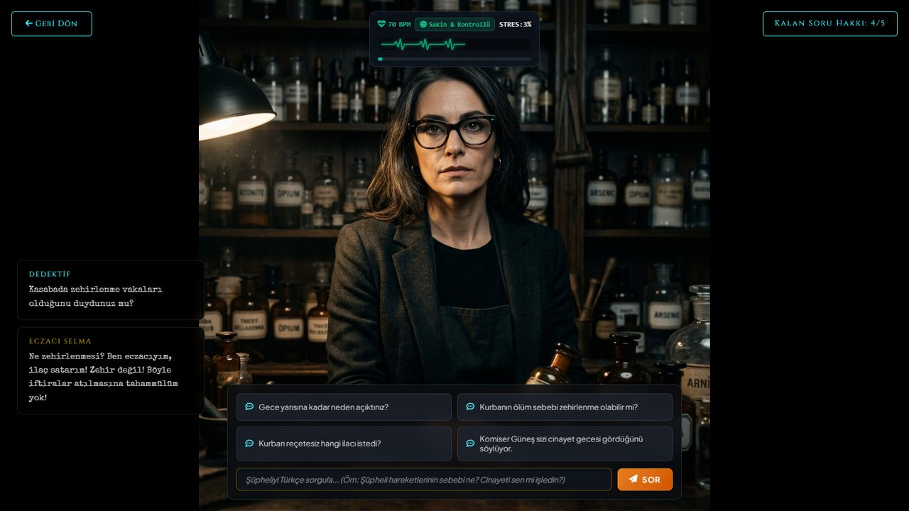<br><sub>🌐 <b>Baskı:</b> nabzı ve stresi izle. Stres 100'e ulaşırsa şüpheli sorguyu terk eder.</sub></td>
  </tr>
</table>

## Kurulum

> [!IMPORTANT]
> Hazır bir indirme paketi henüz yok. **En kolay yol web sürümüdür:** .NET 10 kurup tek komutla çalıştırırsın. 3D sürüm için oyunu Unity ile bir kez derlemen gerekir.

### Önce oyunu indir

Depo yaklaşık 850 MB yer kaplar. Web ve 3D aynı depodadır, 3D sürüm de görsellerini web klasöründen aldığı için **deponun tamamı gerekir.**

[Git](https://git-scm.com/downloads) ile (önerilir):

```powershell
mkdir C:\Oyunlar
cd C:\Oyunlar
git clone --depth 1 https://github.com/eco-polarislogs/Dedektif.git
cd Dedektif
```

Git kullanmıyorsan: bu sayfada **Code > Download ZIP** ile indirip `C:\Oyunlar` altına çıkar.

> [!TIP]
> Kısa bir klasör seç ve OneDrive gibi eşitlenen klasörlerden kaçın. Depoda 200 karakteri geçen dosya yolları var, Windows'un 260 karakter sınırına takılabilirsin.

### Web sürümünü kur

**Gerekenler:** [.NET 10 SDK](https://dotnet.microsoft.com/download) ve güncel bir tarayıcı. Veritabanı kurman gerekmez.

**1. .NET'in kurulu olduğunu kontrol et.** `10` ile başlayan bir sürüm görmelisin:

```powershell
dotnet --version
```

**2. Ayar dosyasını oluştur** (depo klasöründeyken):

```powershell
copy appsettings.Example.json appsettings.json
```

**3. `appsettings.json` dosyasını aç ve Gemini anahtarını boşalt.** Bu adımı atlarsan oyun, dosyadaki örnek değer yüzünden serbest sorularda önce başarısız bir istek dener:

```json
"GeminiApiKey": ""
```

**4. Oyunu başlat.** İlk çalıştırmada paketler indirilir ve diyaloglar veritabanına yüklenir:

```powershell
dotnet run
```

Hazır olduğunda şunları görürsün. PostgreSQL uyarısı normaldir, oyun kendiliğinden SQLite'a geçer:

```text
⚠️ PostgreSQL bağlantısı kurulamadı (...). Güvenli SQLite motoruna geçildi.
🧠 Yerel AI Veritabanında 1.270 adet senaryo ve diyalog aktif!
Now listening on: http://localhost:5000
```

**5. Tarayıcıda [http://localhost:5000](http://localhost:5000) adresini aç** ve **Dosyayı Aç ve Başla** düğmesine bas. Oyunu kapatmak için terminalde `Ctrl+C`.

<details>
<summary><b>İsteğe bağlı: Gemini ve PostgreSQL</b></summary>

**Gemini ile serbest sorular.** Yerel Türkçe motor anahtarsız çalışır. Gemini kullanmak istersen anahtarını `appsettings.json` içindeki `GeminiApiKey` alanına ya da `GEMINI_API_KEY` ortam değişkenine yaz.

**Kendi PostgreSQL sunucun.** Bağlantı bilgilerini `appsettings.json` içinde düzenle. Sunucuya ulaşılamazsa oyun yine SQLite'a döner.

```json
"PostgresConnectionString": "Host=localhost;Port=5432;Database=dedektiflik_rpg_v2;Username=postgres;Password=KENDI_SIFREN"
```

> [!WARNING]
> Şifreni ve API anahtarını **yalnızca** `appsettings.json` içine yaz. Git bu dosyayı yok sayar. Kod dosyalarına, yardımcı betiklere ya da zip arşivlerine koyarsan depoyla birlikte yayınlanır.

**Metin arayüzü.** Oyunu terminalde oynamak için: `dotnet run -- --console`

**macOS ve Linux.** `copy` yerine `cp` kullan. Oyun yalnızca Windows'ta test edildi, .NET 10 olan diğer sistemlerde çalışması bekleniyor.

</details>

<details>
<summary><b>Web sürümünde sorun mu var?</b></summary>

| Belirti | Çözüm |
|---|---|
| `dotnet` komutu bulunamıyor | .NET 10 SDK'yı kur ve terminali kapatıp yeniden aç. |
| `address already in use` veya port hatası | 5000 portunu başka bir program kullanıyor. O programı kapat, adres kodda sabittir. |
| Derlemede sarı uyarılar görünüyor | Oyunun çalışmasını engellemez. |
| Serbest sorular yavaş cevaplanıyor | `GeminiApiKey` alanının boş olduğundan emin ol. |

</details>

### 3D sürümü derle

**Gerekenler:**

- [Unity Hub](https://unity.com/download) ve [Unity 6000.6.7f1](https://unity.com/releases/editor/archive). Windows için ek derleme modülü gerekmez.
- Editöre ek olarak yaklaşık 3 GB boş alan: proje ve Unity önbelleği için 2,4 GB, derlenmiş oyun için 520 MB.
- Windows 10 veya 11, 64 bit ve DirectX 11 destekli bir ekran kartı.

Oyun şu sistemde geliştirildi ve test edildi: i5-8300H, 16 GB RAM, GTX 1050 Ti. Daha zayıf sistemlerde oyun yavaşlarsa grafik kalitesini kendisi bir kademe düşürür.

**1. Projeyi aç.** Unity Hub'da **Add > Add project from disk** seçip depodaki `Dedektif_3D` klasörünü göster. İlk açılışta Unity projeyi içe aktarır, bu uzun sürebilir.

**2. Hemen denemek istersen** `Assets/Scenes/SampleScene.unity` sahnesini açıp **Play**'e bas. Kasabalar çalışma anında kodla kurulur.

**3. Oyunu derle.** Üst menüden **Dedektif > Windows Oyunu Derle** seç. Çıktı burada oluşur:

```text
Dedektif_3D\Build\Windows\Dedektif.exe
```

**4. `Dedektif.exe` dosyasını çalıştır.** İnternet ya da sunucu gerekmez, soruşturman kendiliğinden kaydedilir.

İlk derleme gölgelendiricileri hazırladığı için uzun sürer (test sisteminde yaklaşık 11 dakika), sonrakiler 2 dakikanın altındadır. Dizüstü kullanıyorsan derleme boyunca **prize takılı tut.**

<details>
<summary><b>Komut satırından derleme ve paylaşma</b></summary>

Unity kapalıyken:

```powershell
& "C:\Program Files\Unity\Hub\Editor\6000.6.7f1\Editor\Unity.exe" -batchmode -projectPath Dedektif_3D -executeMethod DedektifBuild.BuildWindows -logFile build.log
```

Oyunu başkasıyla paylaşırken `Build\Windows` klasörünü ziple, içindeki `Dedektif_BackUpThisFolder_ButDontShipItWithYourGame` klasörünü dahil etme.

</details>

<details>
<summary><b>3D sürümde sorun mu var?</b></summary>

| Belirti | Çözüm |
|---|---|
| Unity sürüm uyarısı veriyor | Tam olarak 6000.6.7f1 sürümünü kur. Farklı sürümlerde test edilmedi. |
| Görseller eksik görünüyor | Yalnızca `Dedektif_3D` klasörünü değil, deponun tamamını indir. |
| Oyun açılmıyor ya da ekran donuyor | Ekran kartı sürücüsünü güncelle. |
| Derleme yarıda kesiliyor | Dizüstü pilde kalmış olabilir, prize takılı olarak yeniden başlat. |

</details>

### 3D oyunu yapay zekâ sunucusuna bağla

3D oyun çevrimdışı çalışır. Serbest sorulara yapay zekâ motorunun cevap vermesini istersen önce [web sunucusunu başlat](#web-sürümünü-kur), sonra oyuna adresini ver:

```powershell
Dedektif.exe -server http://localhost:5000
```

Adresi kalıcı yapmak için `Dedektif_Data/StreamingAssets/server.txt` dosyasına yazabilirsin. Unity editöründe oyun bu adresi kendiliğinden dener. Sunucuya ulaşılamazsa yerel modda devam eder.

## Kontroller

🌐 **Web:** Her şey fareyle oynanır. Binalara, delillere ve konuşma balonlarına tıkla. Serbest sorular için klavyeyi kullan.

🎮 **3D:**

| Tuş | İşlev |
|---|---|
| `W` `A` `S` `D` / ok tuşları | Yürü (`Shift` koşar) |
| Fare | Kamera, arama modunda imleci odada gezdirir |
| Sağ tık / `V` | Fareyle aramayı aç veya kapat (bina içinde kendiliğinden açılır) |
| Sol tık | Parlayan şeyi incele: delil, saklama yeri, şüpheli, kapı, ceset |
| `E` | Yakındaki kapı, delil veya şüpheliyle etkileşim |
| `Q` | **Dedektif Gözü:** dünya griye döner, saklama yerleri parlar |
| `Tab` | Çanta ve adli laboratuvar |
| `R` | Otopsi raporu |
| `B` | Vaka panosu |
| `H` | Yardımcı Dedektif (`1` delilleri incele, `2` ipucu, `G` geç) |
| `F` | **BULDUM!** Katili göster |
| `Esc` | Duraklat, ayarlar, ana menü |
| `F1` / `M` / `C` | Kontrol listesi / ses / sinema modu |

Oynanış sırasında gamepad de desteklenir. Ayarlardan parlaklık, ses kanalları, grafik kalitesi, film greni, alan derinliği, kamera sarsıntısı, fare hassasiyeti ve metin hızı değiştirilebilir.

**24 gerçek dakika bir oyun gününe eşittir.** Yeni dava saat 20.00'de başlar. Saat 23.00 ile 05.00 arasında kapı çalarsan şüpheli uykusundan uyanır ve sorguya daha gergin başlar.

## Geliştirme Durumu

Üç kasaba da iki sürümde baştan sona oynanabilir. Sırada olanlar:

- **Yıkıkköy ve Karaorman.** Haritada görünüyorlar ama yolları henüz kapalı.
- **Hazır Windows paketi.** Henüz [Releases](https://github.com/eco-polarislogs/Dedektif/releases) sayfasında yok.
- **3D'ye taşınacaklar.** Yan karakterler, dört açılı delil incelemesi ve Fehmi Bey sahnesi.
- **Görsel iyileştirmeler.** 3D karakter modelleri hâlâ düşük poligonlu, Sisören'deki taş rampa fazla parlak.

<details>
<summary><b>Teknik yapı</b></summary>

| Katman | Teknoloji | Görevi |
|---|---|---|
| **3D oyun** | Unity 6, URP, C# | Kasabaları, odaları ve kıyafetleri kodla kurar, sesleri sentezler |
| **Sunucu** | .NET 10 Minimal API | Oyuncu oturumları, katil seçimi, sorgu, adli tıp ve otopsi |
| **Yapay zekâ** | Yerel Türkçe NLP, isteğe bağlı Gemini | Niyet analizi, stres simülasyonu, çelişki yakalama |
| **Veritabanı** | PostgreSQL veya SQLite, Dapper | Diyaloglar, adli kayıtlar ve oturum verileri |
| **Web arayüzü** | HTML, CSS, JavaScript | Tıkla ve bul arayüzü, adli araçlar, daktilo anlatımı |

```text
Dedektif/
├── Dedektif_3D/                     # Unity projesi
│   └── Assets/
│       ├── Scripts/                 # Core, Gameplay, World, UI, API
│       ├── Resources/               # Kasaba verileri, karakter modelleri, dokular
│       └── Editor/                  # DedektifBuild, DedektifVerify, DedektifShots
├── Controllers/GameEndpoints.cs     # API uç noktaları
├── Data/                            # Veritabanı erişimi, şemalar, diyalog verileri
├── Services/                        # Yerel yapay zekâ, adli tıp, oyuncu oturumları
├── wwwroot/                         # Web oyunu: arayüz, kasaba motorları, görseller
├── docs/                            # Bu sayfadaki görseller
└── Program.cs                       # Sunucu başlangıcı
```

Kök klasördeki `fix_*.py` ve `Fix_*.js` dosyaları geçmişte kullanılmış bakım betikleridir, oyunu çalıştırmak için gerekmez.

</details>

<details>
<summary><b>Testler</b></summary>

**Oynanış doğrulaması.** `DedektifVerify` oyunu batch modda oynatır: okunabilir delilleri, görsel yüklemeyi, kayıt sistemini, fareyle aramayı ve üç kasabanın baştan sona oynanışını sınar. Unity kapalıyken çalıştır, sonuç `verify.txt` dosyasına yazılır. Çıkış kodu `0` başarı, `1` başarısızlık, `2` zaman aşımıdır.

```powershell
$env:DEDEKTIF_SHOTS = "C:\dedektif-test"
& "C:\Program Files\Unity\Hub\Editor\6000.6.7f1\Editor\Unity.exe" -batchmode -projectPath Dedektif_3D -executeMethod DedektifVerify.Run
```

**Paket turu.** Derlenmiş oyun `Dedektif.exe -dedektifShots <klasör>` ile başlatılırsa üç kasabayı kendisi gezer, ekran görüntüsü alır, sonuçları `log.txt` dosyasına yazar ve kapanır.

</details>

## Emeği Geçenler

- **İnsan modelleri ve animasyonları:** [Quaternius](https://quaternius.com) (CC0)
- **Yüzey dokuları:** [Poly Haven](https://polyhaven.com) (CC0)
- **Portreler, haritalar, delil ve web sahne görselleri:** yapay zekâ ile üretildi
- **Oyun motoru:** [Unity](https://unity.com)
- **Görsel araçları:** Banana Studio ve Nashi, yerelde çalıştırıldı. Ayrı açık kaynak projelerdir, oyunu çalıştırmak için gerekmezler.

Görseller: 🎮 kareler paketlenmiş Windows sürümünden, 🌐 kareler tarayıcıda oynanırken alındı. Üstteki afiş ve kasaba başlıkları oyunun web haritalarından hazırlandı.

---

<p align="center">
  <b>Ecren Solmazgül</b> · <a href="https://github.com/eco-polarislogs">GitHub</a><br>
  <sub>Bir kasaba seç. Herkes bir şey saklıyor.</sub>
</p>
